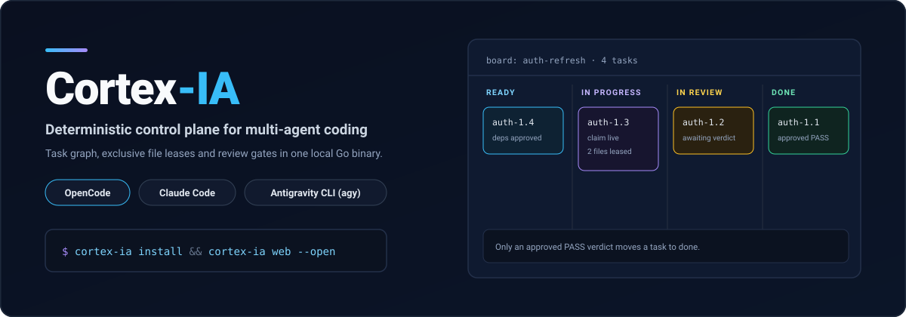
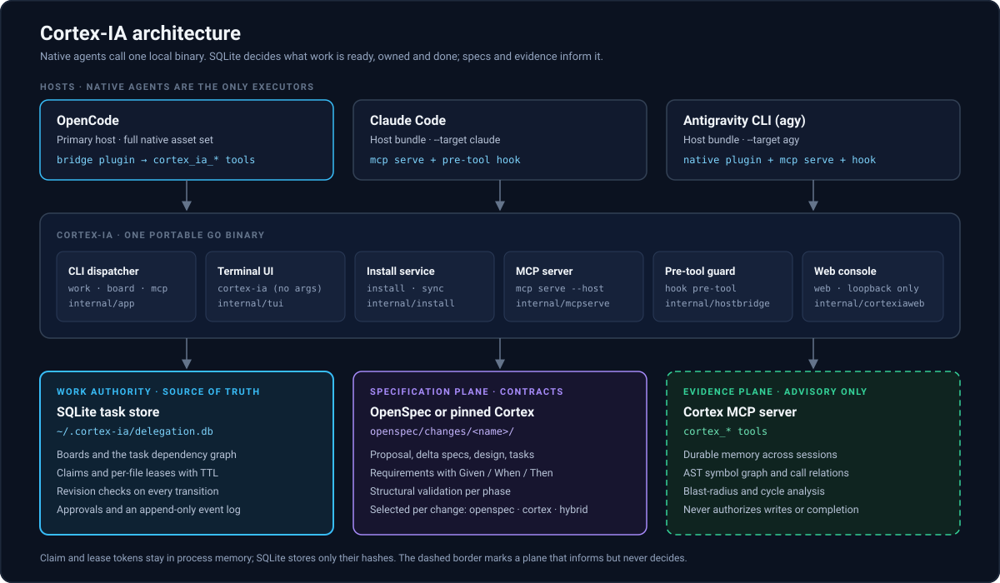
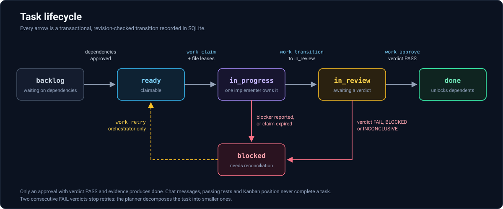
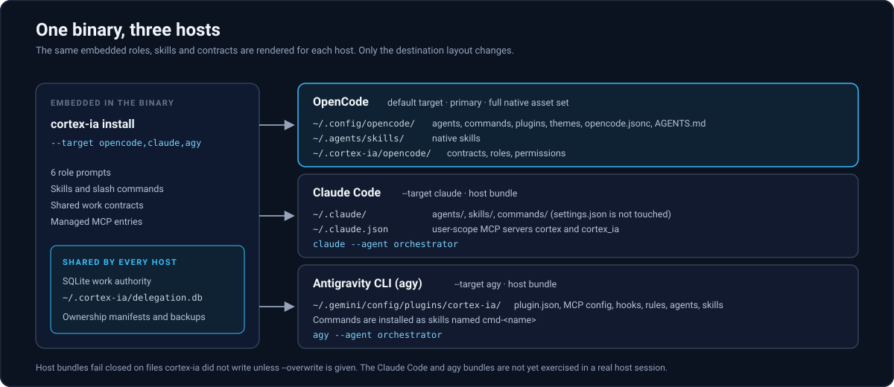
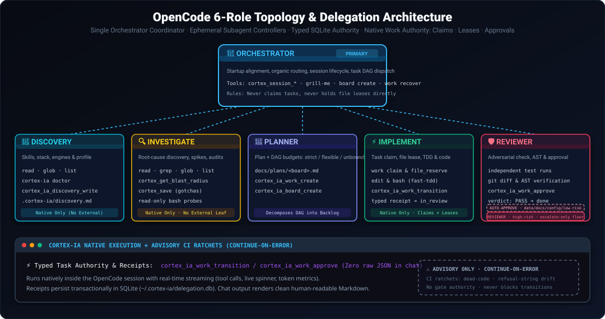
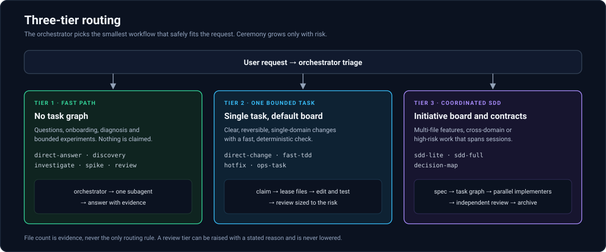
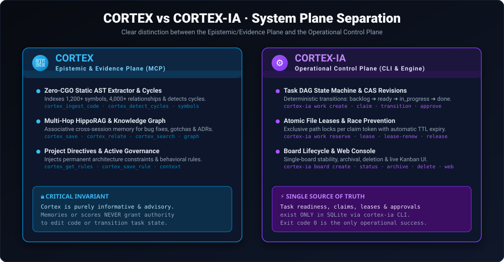
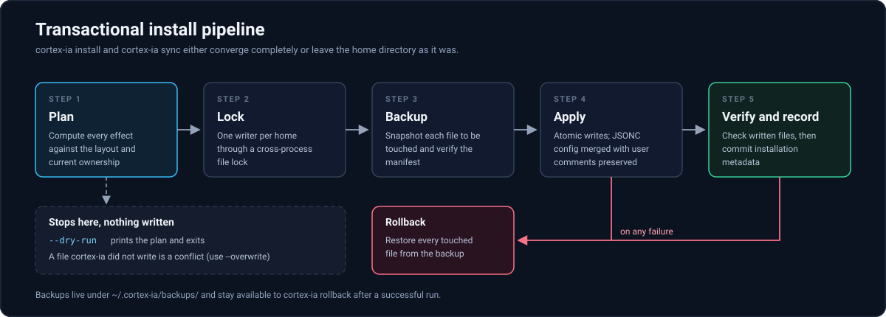

[English](README.md) | **Español**

<p align="center">
  
</p>

<p align="center">
  <a href="https://github.com/lleontor705/cortex-ia/releases/latest"></a>
  <a href="https://github.com/lleontor705/cortex-ia/actions/workflows/ci.yml"></a>
  <a href="https://goreportcard.com/report/github.com/lleontor705/cortex-ia"></a>
  <a href="go.mod"></a>
  <a href="LICENSE"></a>
  <a href="docs/getting-started/platforms.md"></a>
</p>

**Cortex-IA** es un plano de control local para el desarrollo de software multiagente. Instala un
conjunto de roles de agente, skills y contratos en **OpenCode** (principal), **Claude Code** y
**Antigravity CLI (agy)**, y se hace cargo de lo único en lo que no se puede confiar que agentes en
paralelo se pongan de acuerdo por sí solos: qué tarea está lista, quién la tiene, qué archivos puede
escribir y cuándo está terminada. Esa autoridad vive en una base de datos SQLite transaccional,
dentro de un único binario de Go, en tu máquina.

<p align="center">
  <a href="docs/getting-started/quickstart.md"><b>Inicio rápido</b></a> ·
  <a href="docs/index.md"><b>Documentación</b></a> ·
  <a href="docs/reference/cli.md"><b>Referencia de la CLI</b></a> ·
  <a href="docs/architecture/architecture.md"><b>Arquitectura</b></a> ·
  <a href="CHANGELOG.md"><b>Changelog</b></a>
</p>

## Contenido

- [Por qué Cortex-IA](#por-qué-cortex-ia)
- [Cómo funciona](#cómo-funciona)
- [Inicio rápido](#inicio-rápido)
- [Instalación](#instalación)
- [Hosts soportados](#hosts-soportados)
- [Roles de agente](#roles-de-agente)
- [Enrutamiento: tres niveles](#enrutamiento-tres-niveles)
- [Cortex y Cortex-IA](#cortex-y-cortex-ia)
- [Resumen de comandos](#resumen-de-comandos)
- [Garantías de seguridad](#garantías-de-seguridad)
- [Documentación](#documentación)
- [Contribuir](#contribuir)
- [Licencia](#licencia)

## Por qué Cortex-IA

Varios agentes editando un mismo repositorio fallan de formas predecibles. Cortex-IA responde a cada
fallo con un mecanismo que los agentes no pueden esquivar con palabras.

| Modo de fallo | Qué hace Cortex-IA |
|---|---|
| Dos agentes sobrescriben las ediciones del otro | Un implementador debe tener una **concesión de archivo** exclusiva y con vencimiento sobre cada ruta antes de escribirla (`work lease`, `cortex_ia_file_reserve`). |
| Una tarea empieza antes de que sus dependencias estén realmente terminadas | Las tareas forman un **grafo de dependencias**; una tarea pasa a `ready` solo cuando todo aquello de lo que depende tiene un `PASS` aprobado. |
| Dos controladores actúan sobre la misma tarea | Una tarea tiene un solo **claim** a la vez, y cada transición se comprueba contra la **revisión** de la tarea, así que un escritor desactualizado es rechazado. |
| "Terminado" se afirma en el chat, no se demuestra | Solo `work approve --verdict PASS` con evidencia produce `done`. Los cambios de alto riesgo requieren un revisor independiente; el implementador no puede aprobar su propio trabajo. |
| El estado circula como JSON libre en el chat | Las transiciones y los veredictos pasan por **herramientas tipadas** y se guardan en SQLite. El chat lleva un resumen legible. |
| Una instalación corrompe la configuración de agentes del usuario | Instalar y sincronizar son **transaccionales**: plan, copia de seguridad verificada, aplicación atómica y reversión ante fallos. |

## Cómo funciona

<p align="center">
  
</p>

- **Los hosts** ejecutan los agentes. La ejecución es nativa: los agentes del host instalado son los
  únicos ejecutores y no se invoca ninguna CLI externa.
- **El binario** es todo lo que entrega Cortex-IA: CLI, interfaz de terminal, instalador, servidor
  MCP, guardián pre-tool y una consola web solo de loopback.
- **La autoridad de trabajo** es la base de datos SQLite en `~/.cortex-ia/delegation.db`. Es la
  única fuente de verdad para tableros, tareas, claims, concesiones y aprobaciones.
- **El plano de especificación** contiene los contratos de los cambios grandes: archivos OpenSpec en
  el repositorio, observaciones de Cortex fijadas, o ambos.
- **El plano de evidencia** es el servidor MCP de Cortex: memoria, el grafo AST del código y el
  análisis de radio de impacto. Informa las decisiones y nunca las autoriza.

Todas las tareas siguen el mismo ciclo de vida, y cada flecha es una transacción:

<p align="center">
  
</p>

## Inicio rápido

```bash
# 1. Install the binary (Linux / macOS)
curl -sSL https://raw.githubusercontent.com/lleontor705/cortex-ia/main/scripts/install.sh | bash

# 2. Install the agent assets (OpenCode by default)
cortex-ia install

# 3. Check the installation and open the local console
cortex-ia doctor
cortex-ia web --open      # http://127.0.0.1:7331
```

¿Prefieres una configuración guiada? Ejecuta `cortex-ia` sin argumentos para abrir la interfaz de
terminal, que incluye una pantalla de selección de host. El recorrido completo está en el
[Inicio rápido](docs/getting-started/quickstart.md).

## Instalación

| Método | Comando |
|---|---|
| Script de instalación (Linux / macOS) | `curl -sSL https://raw.githubusercontent.com/lleontor705/cortex-ia/main/scripts/install.sh \| bash` |
| Script de instalación (Windows PowerShell) | `irm https://raw.githubusercontent.com/lleontor705/cortex-ia/main/scripts/install.ps1 \| iex` |
| Binario precompilado | Descárgalo desde [Releases](https://github.com/lleontor705/cortex-ia/releases) |
| Go | `go install github.com/lleontor705/cortex-ia/cmd/cortex-ia@latest` |
| Desde el código fuente | `git clone https://github.com/lleontor705/cortex-ia.git && cd cortex-ia && go build -o bin/cortex-ia ./cmd/cortex-ia` |

> **Nota:** las compilaciones desde el código fuente no incorporan el secreto de
> firma de los informes de errores, así que no pueden enviar informes hasta que
> ejecutes `cortex-ia report config --secret <KEY>` (o exportes
> `CORTEX_REPORT_SECRET` antes de `cortex-ia install`, que lo persiste). El
> binario precompilado y los instaladores incorporan el secreto y reportan sin
> configuración adicional — `cortex-ia doctor` te indica cuál tienes.

Los requisitos previos, el comportamiento de actualización y la verificación están en
[Instalación](docs/getting-started/installation.md).

## Hosts soportados

<p align="center">
  
</p>

```bash
cortex-ia install                       # OpenCode only (default)
cortex-ia install --target claude,agy   # host bundles
cortex-ia install --target all
```

| Host | Target | Estado |
|---|---|---|
| **OpenCode** | `opencode` (por defecto) | Principal, conjunto nativo completo de assets |
| **Claude Code** | `claude` | Bundle de host, aún no ejercitado en una sesión real de Claude Code |
| **Antigravity CLI** | `agy` | Bundle de host, aún no ejercitado en una sesión real de agy |

Las rutas, los guardianes de host y los límites conocidos están en
[Plataformas soportadas](docs/getting-started/platforms.md).

## Roles de agente

<p align="center">
  
</p>

| Rol | Responsabilidad | Autoridad sobre el estado de trabajo |
|---|---|---|
| `orchestrator` | Triaje, enrutamiento, ciclo de vida de la sesión, despacho y síntesis final | Crea tableros y tareas, recupera y reintenta; nunca reclama, concesiona ni edita |
| `discovery` | Indexa skills, toolchain y estructura del proyecto en `.cortex-ia/discovery.md` | Ninguna |
| `investigate` | Diagnóstico de causa raíz, spikes y auditorías de solo lectura | Solo lectura |
| `planner` | Especificaciones y el grafo de dependencias de tareas | Crea el tablero de la iniciativa y sus tareas |
| `implement` | Reclama una tarea, concesiona sus archivos, edita y verifica | Claim, concesión y transición a `in_review` |
| `reviewer` | Inspecciona el diff de forma independiente y vuelve a ejecutar las comprobaciones | Solo `work approve` |

Los contratos de rol y los recibos se describen en [Agentes](docs/operations/agents.md).

## Enrutamiento: tres niveles

<p align="center">
  
</p>

| Nivel | Flujos de trabajo | Ejecución |
|---|---|---|
| **1 — Ruta rápida** | `direct-answer`, `discovery`, `investigate`, `spike`, `review` | Un subagente, sin grafo de tareas |
| **2 — Una tarea acotada** | `direct-change`, `fast-tdd`, `hotfix`, `ops-task` | Claim, concesión, edición, verificación y revisión proporcional al riesgo |
| **3 — SDD coordinado** | `sdd-lite`, `sdd-full` | Tablero de iniciativa, especificación, grafo de dependencias, implementadores en paralelo y revisión independiente |

La matriz de fases completa está en la [guía del flujo SDD](docs/operations/sdd-workflow.md).

## Cortex y Cortex-IA

Dos componentes con nombres parecidos y trabajos distintos.

<p align="center">
  
</p>

| | **Cortex** (servidor MCP) | **Cortex-IA** (este repositorio) |
|---|---|---|
| Qué es | Un servidor MCP que expone las herramientas `cortex_*` | Un binario de Go: CLI, TUI, instalador y consola web |
| Qué guarda | Memorias, el grafo de símbolos AST y relaciones | Tableros, tareas, claims, concesiones y aprobaciones |
| Autoridad | Consultiva. Nunca autoriza una escritura ni completa una tarea | La única fuente de verdad del estado de trabajo |

Más en [Memoria de Cortex](docs/operations/cortex-memory.md).

## Resumen de comandos

| Grupo | Propósito |
|---|---|
| `cortex-ia` (sin argumentos) | Interfaz de terminal |
| `install`, `sync`, `doctor`, `uninstall`, `update` | Instalar y mantener los assets de agente |
| `rollback`, `recover` | Restaurar una copia de seguridad o un journal de recuperación pendiente |
| `board` | Crear e inspeccionar tableros de tareas |
| `work` | Tareas, claims, concesiones, transiciones y aprobaciones |
| `openspec` | Crear, validar y archivar cambios de especificación |
| `mcp` | Gestionar entradas de servidores MCP; `mcp serve` es el servidor MCP de host |
| `model` | Asignaciones de modelo por agente |
| `web` | Consola de operaciones local |
| `ledger`, `stats`, `report`, `doc`, `diagram` | Hechos y progreso, estadísticas de uso, informes de errores, conversión de documentos y diagramas |

Todos los comandos, flags y alias están en la [referencia de la CLI](docs/reference/cli.md).

## Garantías de seguridad

<p align="center">
  
</p>

- **Determinismo de dry-run**: `--dry-run` calcula el plan exacto y no escribe nada.
- **Un escritor por home**: cada comando que muta estado mantiene un bloqueo de archivo entre procesos.
- **Copias de seguridad verificadas y reversión**: los archivos afectados se guardan en
  `~/.cortex-ia/backups/` y se restauran automáticamente si la fase de aplicación falla.
- **Propiedad con cierre ante fallos**: los archivos que Cortex-IA no escribió son un conflicto, no
  algo que sobrescribir.
- **Aislamiento de rutas**: las concesiones y las operaciones del espacio de trabajo rechazan el
  recorrido de directorios (`..`) y los escapes por rutas absolutas.
- **Consola solo de loopback**: la consola web se enlaza a `localhost` y no expone ninguna mutación
  de claim, concesión o aprobación.

Detalles en [Seguridad y recuperación](docs/operations/security.md) y
[Copias de seguridad y reversión](docs/operations/rollback.md).

## Documentación

El índice de la documentación es [docs/index.md](docs/index.md). Las páginas más usadas:

| Si quieres… | Lee |
|---|---|
| Ponerlo en marcha | [Quickstart](docs/getting-started/quickstart.md) · [Installation](docs/getting-started/installation.md) · [Configuration](docs/getting-started/configuration.md) |
| Automatizarlo o ejecutarlo en CI | [Non-interactive mode](docs/getting-started/non-interactive.md) · [CLI reference](docs/reference/cli.md) |
| Entender el diseño | [Architecture](docs/architecture/architecture.md) · [Agents](docs/operations/agents.md) · [SDD workflow](docs/operations/sdd-workflow.md) |
| Operarlo | [MCP manager](docs/operations/mcp.md) · [Web console](docs/operations/web-console.md) · [Security and recovery](docs/operations/security.md) · [Backups and rollback](docs/operations/rollback.md) |
| Trabajar en el código | [Codebase guide](docs/architecture/codebase-guide.md) · [Repository map](docs/architecture/codebase/repository-map.md) · [Maintainer playbook](docs/architecture/codebase/maintainer-playbook.md) |

## Contribuir

Las contribuciones siguen un flujo issue-first. Lee [CONTRIBUTING.md](CONTRIBUTING.md) antes de
abrir un pull request, y el [Código de Conducta](CODE_OF_CONDUCT.md). Reporta vulnerabilidades de
forma privada como se describe en [SECURITY.md](SECURITY.md). Para preguntas, consulta
[SUPPORT.md](SUPPORT.md).

## Licencia

[MIT](LICENSE) © [Luis León](https://github.com/lleontor705)
