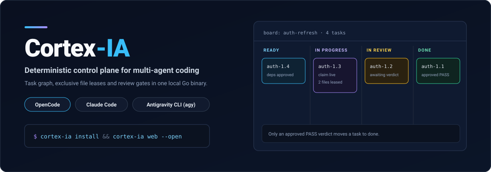
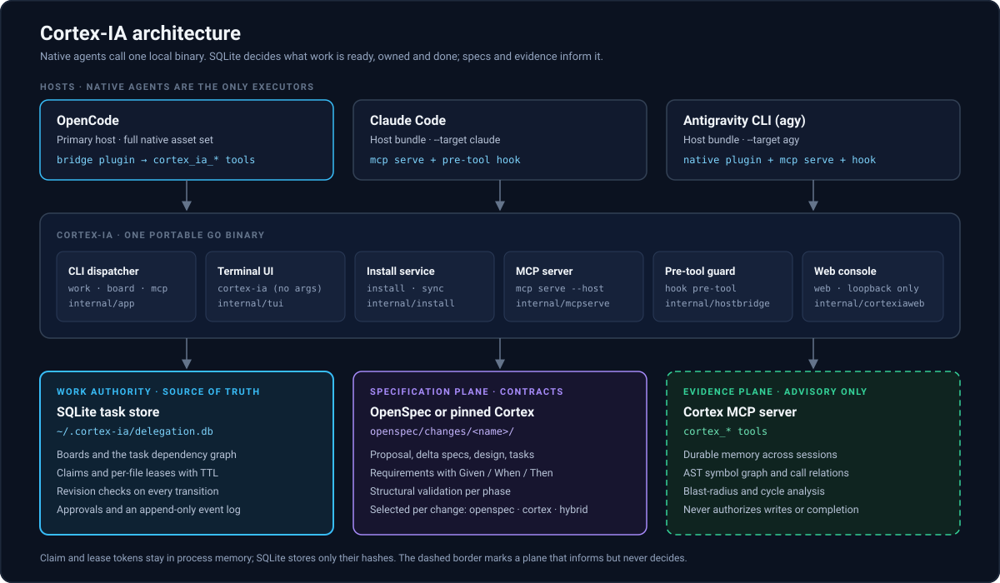
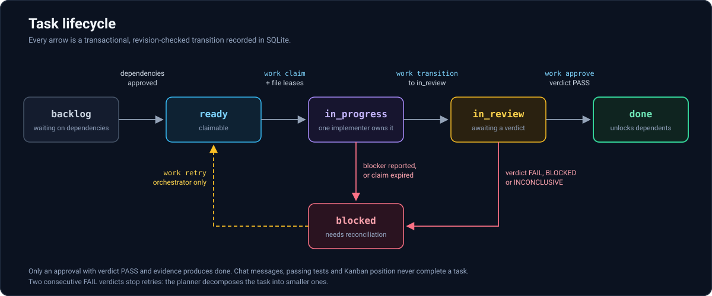
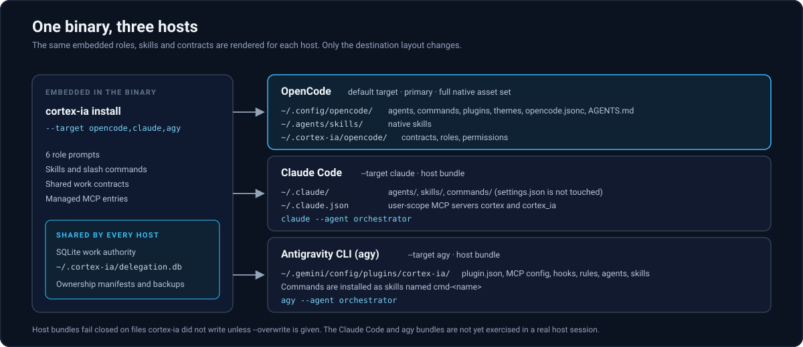
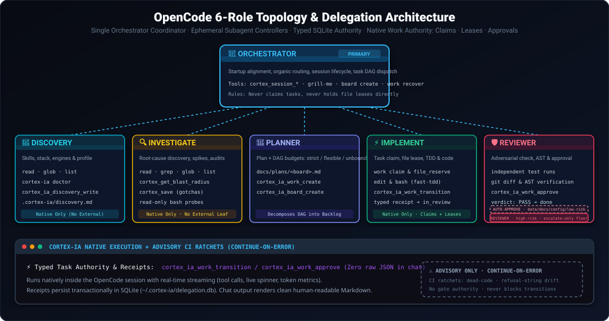
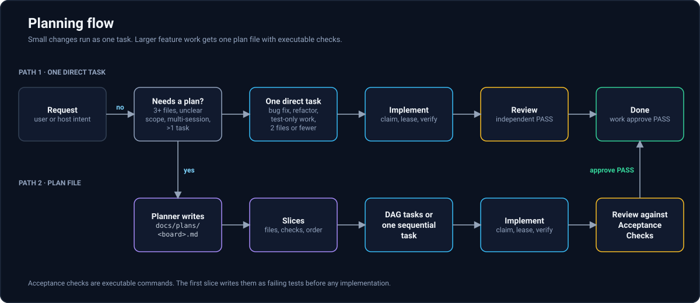
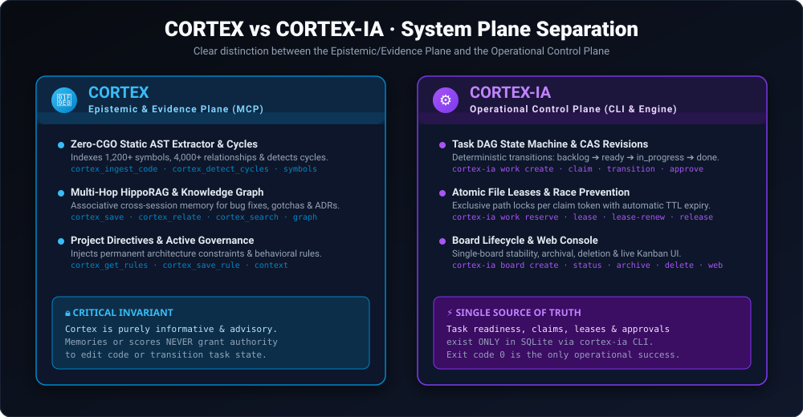
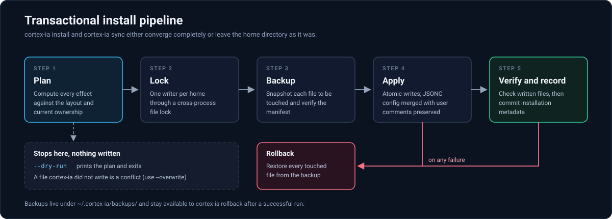

<p align="center">
  
</p>

<p align="center">
  <a href="https://github.com/lleontor705/cortex-ia/releases/latest"></a>
  <a href="https://github.com/lleontor705/cortex-ia/actions/workflows/ci.yml"></a>
  <a href="https://goreportcard.com/report/github.com/lleontor705/cortex-ia"></a>
  <a href="go.mod"></a>
  <a href="LICENSE"></a>
  <a href="docs/getting-started/platforms.md"></a>
</p>

**English** | [Español](README.es.md)

**Cortex-IA** is a local control plane for multi-agent software development. It installs a set of
agent roles, skills and contracts into **OpenCode** (primary), **Claude Code** and **Antigravity CLI
(agy)**, and it owns the one thing parallel agents cannot be trusted to agree on by themselves: which
task is ready, who owns it, which files they may write, and when it is done. That authority lives in
a transactional SQLite database, in a single Go binary, on your machine.

<p align="center">
  <a href="docs/getting-started/quickstart.md"><b>Quickstart</b></a> ·
  <a href="docs/index.md"><b>Documentation</b></a> ·
  <a href="docs/reference/cli.md"><b>CLI reference</b></a> ·
  <a href="docs/architecture/architecture.md"><b>Architecture</b></a> ·
  <a href="CHANGELOG.md"><b>Changelog</b></a>
</p>

## Contents

- [Why Cortex-IA](#why-cortex-ia)
- [How it works](#how-it-works)
- [Quick start](#quick-start)
- [Installation](#installation)
- [Supported hosts](#supported-hosts)
- [Agent roles](#agent-roles)
- [Planning](#planning)
- [Cortex and Cortex-IA](#cortex-and-cortex-ia)
- [Command overview](#command-overview)
- [Safety guarantees](#safety-guarantees)
- [Documentation](#documentation)
- [Contributing](#contributing)
- [License](#license)

## Why Cortex-IA

Several agents editing one repository fail in predictable ways. Cortex-IA answers each failure with
a mechanism the agents cannot talk their way around.

| Failure mode | What Cortex-IA does |
|---|---|
| Two agents overwrite each other's edits | An implementer must hold an exclusive, expiring **file lease** on every path before writing it (`work lease`, `cortex_ia_file_reserve`). |
| A task starts before its dependencies are really finished | Tasks form a **dependency graph**; a task becomes `ready` only when everything it depends on has an approved `PASS`. |
| Two controllers act on the same task | A task has one **claim** at a time, and every transition is checked against the task's **revision**, so a stale writer is refused. |
| "Done" is asserted in chat, not proven | Only `work approve --verdict PASS` with evidence produces `done`. High-risk changes need an independent reviewer; the implementer cannot approve its own work. |
| State is passed around as free-form JSON in chat | Transitions and verdicts go through **typed tools** and are stored in SQLite. Chat carries a readable summary. |
| An install corrupts the user's agent configuration | Install and sync are **transactional**: plan, verified backup, atomic apply, rollback on failure. |

## How it works

<p align="center">
  
</p>

- **Hosts** run the agents. Execution is native: the agents of the installed host are the only
  executors, and no external CLI is shelled out to.
- **The binary** is everything Cortex-IA ships: CLI, terminal UI, installer, MCP server, pre-tool
  guard and a loopback-only web console.
- **Work authority** is the SQLite database at `~/.cortex-ia/delegation.db`. It is the single source
  of truth for boards, tasks, claims, leases and approvals.
- **Plan files** hold the goal and executable acceptance checks for larger changes, in
  `docs/plans/`. They stay as history; the tests are the living spec.
- **The evidence plane** is the Cortex MCP server: memory, the AST code graph and blast-radius
  analysis. It informs decisions and never authorizes them.

Every task follows the same lifecycle, and each arrow is a transaction:

<p align="center">
  
</p>

## Quick start

```bash
# 1. Install the binary (Linux / macOS)
curl -sSL https://raw.githubusercontent.com/lleontor705/cortex-ia/main/scripts/install.sh | bash

# 2. Install the agent assets (OpenCode by default)
cortex-ia install

# 3. Check the installation and open the local console
cortex-ia doctor
cortex-ia web --open      # http://127.0.0.1:7331
```

Prefer a guided setup? Run `cortex-ia` with no arguments to open the terminal UI, which includes a
host selection screen. The full walkthrough is in the [Quickstart](docs/getting-started/quickstart.md).

## Installation

| Method | Command |
|---|---|
| Install script (Linux / macOS) | `curl -sSL https://raw.githubusercontent.com/lleontor705/cortex-ia/main/scripts/install.sh \| bash` |
| Install script (Windows PowerShell) | `irm https://raw.githubusercontent.com/lleontor705/cortex-ia/main/scripts/install.ps1 \| iex` |
| Precompiled binary | Download from [Releases](https://github.com/lleontor705/cortex-ia/releases) |
| Go | `go install github.com/lleontor705/cortex-ia/cmd/cortex-ia@latest` |
| From source | `git clone https://github.com/lleontor705/cortex-ia.git && cd cortex-ia && go build -o bin/cortex-ia ./cmd/cortex-ia` |

> **Note:** source builds do not embed the error-reporting signing secret, so
> they cannot send reports until you run `cortex-ia report config --secret <KEY>`
> (or export `CORTEX_REPORT_SECRET` before `cortex-ia install`, which persists
> it). The precompiled binary and the installers embed the secret and report
> out of the box — `cortex-ia doctor` tells you which one you have.

Prerequisites, update behavior and verification are covered in
[Installation](docs/getting-started/installation.md).

## Supported hosts

<p align="center">
  
</p>

```bash
cortex-ia install                       # OpenCode only (default)
cortex-ia install --target claude,agy   # host bundles
cortex-ia install --target all
```

| Host | Target | Status |
|---|---|---|
| **OpenCode** | `opencode` (default) | Primary, full native asset set |
| **Claude Code** | `claude` | Host bundle, not yet exercised in a real Claude Code session |
| **Antigravity CLI** | `agy` | Host bundle, not yet exercised in a real agy session |

Paths, host guards and known limits are in [Supported Platforms](docs/getting-started/platforms.md).

## Agent roles

<p align="center">
  
</p>

| Role | Responsibility | Work-state authority |
|---|---|---|
| `orchestrator` | Triage, routing, session lifecycle, dispatch, final synthesis | Creates boards and tasks, recovers and retries; never claims, leases or edits |
| `discovery` | Indexes skills, toolchain and project layout into `.cortex-ia/discovery.md` | None |
| `investigate` | Root-cause diagnosis, spikes, read-only audits | Read-only |
| `planner` | Plan files and the task dependency graph | Creates the initiative board and its tasks |
| `implement` | Claims one task, leases its files, edits, verifies | Claim, lease, transition to `in_review` |
| `reviewer` | Independently inspects the diff and reruns checks | `work approve` only |

Role contracts and receipts are described in [Agents](docs/operations/agents.md).

## Planning

<p align="center">
  
</p>

Small changes run directly as one task. Bug fixes with a reproducing test, refactors under green
tests, test-only work and changes to two files or fewer need no plan. Feature work across three or
more files, with unclear requirements, across several sessions, or in more than one task gets one
plan file, `docs/plans/<board-id>.md`, whose acceptance checks are executable commands. The format,
workflows and task lifecycle are in the [planning guide](docs/operations/planning.md).

## Cortex and Cortex-IA

Two components with similar names and separate jobs.

<p align="center">
  
</p>

| | **Cortex** (MCP server) | **Cortex-IA** (this repository) |
|---|---|---|
| What it is | An MCP server exposing `cortex_*` tools | A Go binary: CLI, TUI, installer, web console |
| What it stores | Memories, the AST symbol graph, relationships | Boards, tasks, claims, leases, approvals |
| Authority | Advisory. Never authorizes a write or completes a task | The single source of truth for work state |

More in [Cortex memory](docs/operations/cortex-memory.md).

## Command overview

| Group | Purpose |
|---|---|
| `cortex-ia` (no arguments) | Terminal UI |
| `install`, `sync`, `doctor`, `uninstall`, `update` | Install and maintain the agent assets |
| `rollback`, `recover` | Restore a backup or a pending recovery journal |
| `board` | Create and inspect task boards |
| `work` | Tasks, claims, leases, transitions and approvals |
| `mcp` | Manage MCP server entries; `mcp serve` is the host MCP server |
| `model` | Per-agent model assignments |
| `web` | Local operations console |
| `ledger`, `stats`, `report`, `doc`, `diagram` | Facts and progress, usage statistics, error reports, document conversion, diagrams |

Every command, flag and alias is listed in the [CLI reference](docs/reference/cli.md).

## Safety guarantees

<p align="center">
  
</p>

- **Dry-run determinism**: `--dry-run` computes the exact plan and writes nothing.
- **One writer per home**: every mutating command holds a cross-process file lock.
- **Verified backups and rollback**: affected files are snapshotted under `~/.cortex-ia/backups/`
  and restored automatically if the apply phase fails.
- **Fail-closed ownership**: files Cortex-IA did not write are a conflict, not something to overwrite.
- **Path sandboxing**: leases and workspace operations reject traversal (`..`) and absolute-path escapes.
- **Loopback-only console**: the web console binds to `localhost` and exposes no claim, lease or
  approval mutation.

Details in [Security and recovery](docs/operations/security.md) and
[Backups and rollback](docs/operations/rollback.md).

## Documentation

The documentation index is [docs/index.md](docs/index.md). The most used pages:

| If you want to… | Read |
|---|---|
| Get running | [Quickstart](docs/getting-started/quickstart.md) · [Installation](docs/getting-started/installation.md) · [Configuration](docs/getting-started/configuration.md) |
| Script it or run it in CI | [Non-interactive mode](docs/getting-started/non-interactive.md) · [CLI reference](docs/reference/cli.md) |
| Understand the design | [Architecture](docs/architecture/architecture.md) · [Agents](docs/operations/agents.md) · [Planning](docs/operations/planning.md) |
| Operate it | [MCP manager](docs/operations/mcp.md) · [Web console](docs/operations/web-console.md) · [Security and recovery](docs/operations/security.md) · [Backups and rollback](docs/operations/rollback.md) |
| Work on the codebase | [Codebase guide](docs/architecture/codebase-guide.md) · [Repository map](docs/architecture/codebase/repository-map.md) · [Maintainer playbook](docs/architecture/codebase/maintainer-playbook.md) |

## Contributing

Contributions follow an issue-first workflow. Read [CONTRIBUTING.md](CONTRIBUTING.md) before opening
a pull request, and the [Code of Conduct](CODE_OF_CONDUCT.md). Report vulnerabilities privately as
described in [SECURITY.md](SECURITY.md). For questions, see [SUPPORT.md](SUPPORT.md).

## License

[MIT](LICENSE) © [Luis León](https://github.com/lleontor705)
