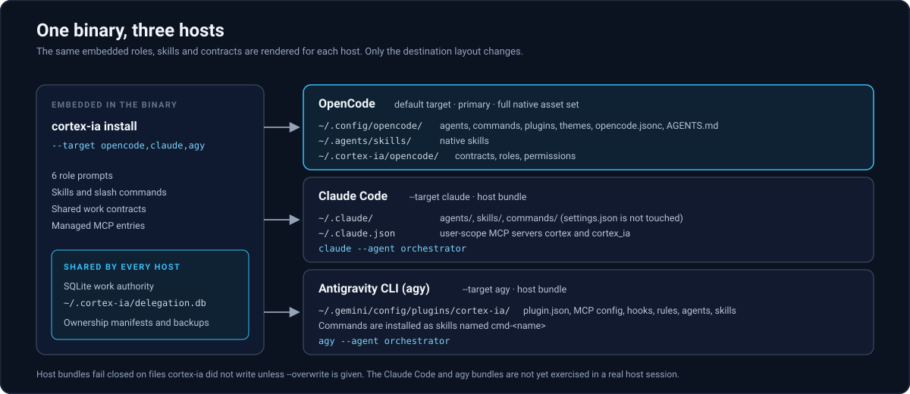

> **English only** — this page has no Spanish translation yet. The Spanish site
> falls back to this English version.
>
> **Solo en inglés** — esta página aún no tiene traducción al español. El sitio en
> español muestra esta versión en inglés.

# Supported Platforms

Release binaries are published for the platforms declared in
`.goreleaser.yaml`: **linux**, **darwin**, and **windows** (amd64/arm64 as
configured per release).

## Notes by Platform

- **Windows**: all destination writes use atomic file replacement and
  reject paths that traverse symlinks or reparse points. Case-insensitive
  destination collisions are detected and fail closed at mapping time, so
  two assets differing only by case can never overwrite each other. No
  symlink creation privilege is required for install, sync, or tests.
- **macOS**: case-insensitive destination collision detection applies for
  the same reason as Windows.
- **Linux**: standard behavior; case-sensitive filesystems get the strict
  collision check.

## Paths

All managed writes are confined to the declared roots beneath the user's home directory:

| Root | Contents |
|------|----------|
| `~/.config/opencode/` | Config (`opencode.jsonc`), `AGENTS.md`, agents, commands, plugins, themes, tui-plugins |
| `~/.agents/skills/` | Native skills (`<name>/SKILL.md`) |
| `~/.cortex-ia/opencode/` | Cortex-IA workflow roots: contracts, roles, overlays, quality, manifests, models, permissions |
| `~/.cortex-ia/` | Installation metadata, lock, MCP digests, backups |

The `claude` and `agy` targets write only the paths listed in the host table below.

The transactional pipeline validates every destination against the layout
declaration before writing; absolute paths and traversal outside these
roots fail closed.

## Target AI Platforms

| Host (`--target`) | Status | What is written, and where | How to start |
| :--- | :--- | :--- | :--- |
| **OpenCode** (`opencode`, default) | Primary, full native asset set | `~/.config/opencode/` (agents, commands, plugins, themes, tui-plugins, `opencode.jsonc`, `AGENTS.md`), `~/.agents/skills/`, `~/.cortex-ia/opencode/`, managed MCPs | Native agents inside OpenCode (see [Quickstart](quickstart.md)) |
| **Claude Code** (`claude`, alias `claude-code`) | Host bundle, not yet exercised in a real Claude Code session | Role agents in `~/.claude/agents/<role>.md`; skills in `~/.claude/skills/<name>/SKILL.md`; commands in `~/.claude/commands/<name>.md`; contracts in `~/.cortex-ia/claude/contracts/`; user-scope MCP servers `cortex` and `cortex_ia` in `~/.claude.json`. `~/.claude/settings.json` is not touched and no global rules file is installed. | `claude --agent orchestrator` |
| **Antigravity CLI** (`agy`, alias `antigravity`) | Host bundle, not yet exercised in a real agy session | Native plugin at `~/.gemini/config/plugins/cortex-ia/` (`plugin.json`, `mcp_config.json`, `hooks.json`, `rules/AGENTS.md`, `agents/`, `skills/`); contracts in `~/.cortex-ia/agy/contracts/`; plugin enabled in `~/.gemini/config/config.json` | `agy --agent orchestrator` |

- `--target` takes `opencode`, `claude`, `agy`, a comma-separated list, or `all`.
  With no `--target`, the CLI installs OpenCode only. The TUI shows a host
  selection screen for Install and Uninstall, pre-selecting the hosts whose
  CLI is detected.
- agy plugins have no commands, so each command is installed as a skill named
  `cmd-<name>`.
- The agy install runs `agy plugin validate` when `agy` is on `PATH`.
- Host roles are not separate prompts: role bodies, skills, and contracts are
  the same embedded assets. Each host receives a short "Host adaptation"
  preamble that maps tool names and rewrites the contracts path.
- Host bundles keep an ownership manifest at `~/.cortex-ia/targets/<target>/manifest.json`
  and back up files under `~/.cortex-ia/targets/<target>/backups/` before any
  overwrite or JSON mutation. Files cortex-ia did not write are a conflict:
  the install fails closed unless `--overwrite` is given. Uninstall removes only
  unmodified owned files and owned JSON keys.
- Host guard: `cortex-ia hook pre-tool --host <claude|agy>` is invoked by the
  host hooks. It denies file writes without a live session-owned lease, denies
  work-authority CLI verbs and direct database access from the shell, and gates
  `cortex_ia_*` tools by role. It fails closed on internal errors.
- The `cortex_ia` MCP server is `cortex-ia mcp serve --host <claude|agy>`, a stdio
  server that exposes the same `cortex_ia_*` tools as the OpenCode bridge plugin.

### Known limits (Claude Code and agy)

- Neither host bundle has been exercised inside a real Claude Code or agy
  session. Verification so far is automated tests, the `agy plugin validate`
  validator, and scripted smokes in a temporary home.
- No equivalent on these hosts for: the OpenCode TUI plugin and themes,
  per-agent temperature, the dispatch-envelope normalisation and re-dispatch
  latch of the transport plugin, compaction-summary injection, and tool telemetry.
- agy hook payloads do not identify the calling subagent. When the caller cannot
  be bound, lease admission on agy degrades to "the path is leased by a live task
  of this workspace" instead of "the caller holds the lease", and the agy guard
  only applies in workspaces that have active cortex-ia work.
- Role gating of `cortex_ia_*` tools on agy relies on each agent's tool list and
  prompt; the agy hook cannot see the role.
- Claude Code hooks do not block a call when the hook process itself times out
  or crashes; the guard fails closed only for errors it can report.
- Shell writes (`sed -i`, redirections) are not lease-checked on any host.

Execution stays native on every host: no external CLI receives work by being
shelled out to, and the retired execution leaf, `delegate`, `herdr` bridge,
personas, profiles, model routing, SDD compiler/registry, ForgeSpec, the external
task-board MCP, and `isolated_worktree` remain retired and fail closed.

## Shells and Terminals

The TUI runs in any terminal Bubble Tea supports. Destructive CLI
operations (`--overwrite`, `mcp remove`, `rollback`, `uninstall`) require
an **interactive terminal** for their confirmation prompt; piped input
fails closed by design — scripts should use `--dry-run`.
