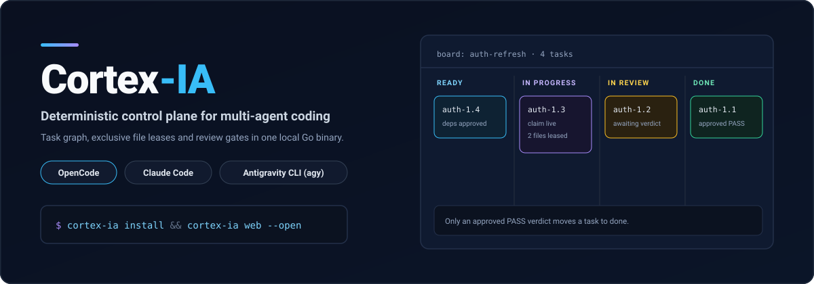
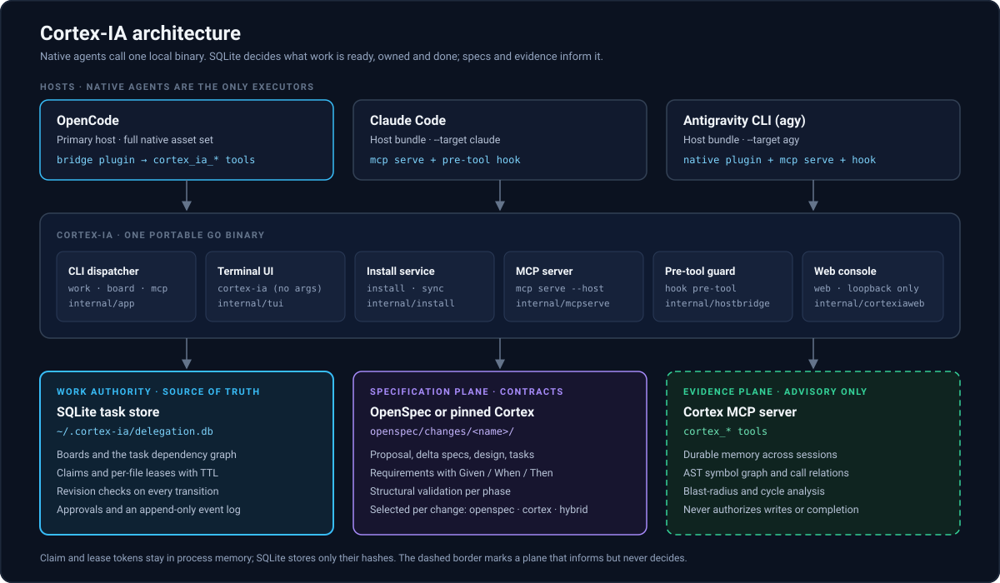

[English](index.md) | **Español**

# Documentación de Cortex-IA

**Cortex-IA** es un plano de control local para el desarrollo de software multiagente sobre
**OpenCode**, **Claude Code** y **Antigravity CLI (agy)**. Un único binario de Go instala los roles
de agente y es dueño del grafo de tareas, las concesiones de archivo y las barreras de revisión que
hacen seguro el trabajo de agentes en paralelo.

## Empieza aquí

| Inicio rápido | Instalación | Referencia de la CLI | Arquitectura |
|---|---|---|---|
| Instala, configura un host y abre la consola. | Todos los métodos de instalación, requisitos y actualizaciones. | Todos los comandos, flags y alias. | Planos, paquetes e invariantes. |
| [Empezar →](getting-started/quickstart.md) | [Instalar →](getting-started/installation.md) | [Consultar →](reference/cli.md) | [Explorar →](architecture/architecture.md) |

## El sistema en una imagen

Los agentes se ejecutan de forma nativa dentro del host. Llegan a Cortex-IA mediante herramientas
tipadas `cortex_ia_*`, y Cortex-IA registra cada claim, concesión, transición y aprobación en
SQLite. Las especificaciones y la memoria de Cortex informan el trabajo; solo SQLite decide su
estado.

## Mapa de la documentación

La documentación está organizada según lo que intentas hacer.

### Primeros pasos

Aprender haciendo: de cero a una instalación funcional.

| Página | Qué cubre |
|---|---|
| [Inicio rápido](getting-started/quickstart.md) | Primera instalación, comprobación de salud y primer tablero |
| [Instalación](getting-started/installation.md) | Scripts de instalación, Go, Homebrew, compilación y actualizaciones |
| [Plataformas soportadas](getting-started/platforms.md) | Sistemas operativos, hosts, rutas de instalación y límites conocidos |
| [Configuración](getting-started/configuration.md) | Flags, variables de entorno y estructura del estado |
| [Modo no interactivo](getting-started/non-interactive.md) | Scripts, CI y códigos de salida |

### Guías

Páginas orientadas a tareas para el uso diario de Cortex-IA.

| Página | Qué cubre |
|---|---|
| [Agentes](operations/agents.md) | Los seis roles, su autoridad y sus recibos |
| [Flujo SDD](operations/sdd-workflow.md) | Desarrollo guiado por especificaciones y verificación por capas |
| [Gestor de MCP](operations/mcp.md) | Presets del catálogo, servidores propios, propiedad y adopción |
| [Componentes](operations/components.md) | Qué se instala y qué servidores MCP se gestionan |
| [Memoria de Cortex](operations/cortex-memory.md) | Memoria, grafo AST y su relación con la autoridad de trabajo |
| [Consola web](operations/web-console.md) | La consola de operaciones de loopback y su API |
| [Estadísticas y TUI](operations/stats-and-ui.md) | `cortex-ia stats` y la cabina de terminal |
| [Seguridad y recuperación](operations/security.md) | Reglas de cierre ante fallos, copias verificadas y recuperación |
| [Copias de seguridad y reversión](operations/rollback.md) | Estructura de las copias, retención y reversión explícita |
| [Pruebas E2E con Docker](operations/docker-e2e-testing.md) | La suite de extremo a extremo basada en contenedores |

### Conceptos y arquitectura

Contexto para entender por qué el sistema se comporta como lo hace.

| Página | Qué cubre |
|---|---|
| [Arquitectura](architecture/architecture.md) | Planos, motor de bloqueo, pipeline de instalación y endurecimiento |
| [Guía del código](architecture/codebase-guide.md) | Ruta de lectura por las páginas de código siguientes |
| [Modelo mental](architecture/codebase/mental-model.md) | El flujo de extremo a extremo en una página |
| [Mapa del repositorio](architecture/codebase/repository-map.md) | Estructura directorio por directorio |
| [Interfaces](architecture/codebase/interfaces.md) | Interfaces de Go y modelos de datos principales |
| [Límites de MCP](architecture/codebase/mcp-boundaries.md) | Propiedad y conflictos con cierre ante fallos en entradas MCP |
| [Coordinación SDD](architecture/codebase/sdd-coordination.md) | Ciclo de vida del trabajo, enrutamiento y reglas de autoridad |
| [Sincronización, estado y copias](architecture/codebase/sync-and-cloud.md) | Archivos de estado y reconciliación |
| [Dashboard y TUI](architecture/codebase/dashboard.md) | Arquitectura de Bubble Tea y pantallas |
| [Integraciones y CI/CD](architecture/codebase/integrations.md) | Workflows, GoReleaser y distribución |
| [Guía de proyecto y extensión](architecture/codebase/project-and-extension.md) | Añadir skills, comandos y presets de MCP |
| [Manual del mantenedor](architecture/codebase/maintainer-playbook.md) | Procedimiento de release y mantenimiento de dependencias |

### Referencia

Datos para consultar.

| Página | Qué cubre |
|---|---|
| [Referencia de la CLI](reference/cli.md) | Todos los grupos de comandos, su sintaxis y propósito |
| [Mapa de referencia](architecture/codebase/reference-map.md) | Paquetes, tipos clave y archivos de configuración y estado |
| [Verificación del actualizador](reference/updater-verification-profiles.md) | Cómo la autoactualización verifica los archivos del release |
| [Claves de firma de releases](operations/release-keys.md) | Esquema de firma retirado y modelo actual de checksums |
| [Tema Nan Ink](reference/nan-ink-theme.md) | Paleta y activación del tema |
| [Snapshot del report hub](reference/cortex-report-hub-snapshot.md) | Utilidad de snapshot de informes de errores |
| [Entradas de cualificación](reference/qualification-inputs.md) · [SDK](reference/sdk-qualification.md) · [MCP](reference/mcp-qualification.md) | Evidencia fijada de CI, SDK y MCP |

### Registros del proyecto

Material fechado y de solo adición que se conserva por trazabilidad.

| Página | Qué cubre |
|---|---|
| [Auditorías](audits/README.md) | Informes de auditoría fechados |
| [Evidencia](evidence/README.md) | Archivos de evidencia referenciados por auditorías y revisiones |
| [Paper de mejora del harness](analysis/harness-improvement-paper.md) | Análisis detrás del diseño actual del harness |
| [Backlog de adopción de autoridad](proposals/gentle-ai-authority-adoption-backlog.md) | Backlog de propuestas sobre patrones de autoridad duradera |

## Convenciones

- El inglés es el idioma canónico. Las páginas con gemela en español usan el sufijo `.es.md`; el
  resto recurre al inglés en el sitio en español.
- Los diagramas son archivos SVG en `assets/diagrams/`; consulta la [guía de assets](assets/README.md)
  antes de añadir o editar uno.
- Los comandos en bloques de código están pensados para copiarse tal cual. Los marcadores de
  posición usan `<corchetes-angulares>`.

## Participa

- Código fuente y versiones: [github.com/lleontor705/cortex-ia](https://github.com/lleontor705/cortex-ia)
- Guía de contribución: [CONTRIBUTING.md](https://github.com/lleontor705/cortex-ia/blob/main/CONTRIBUTING.md)
- Política de seguridad: [SECURITY.md](https://github.com/lleontor705/cortex-ia/blob/main/SECURITY.md)
