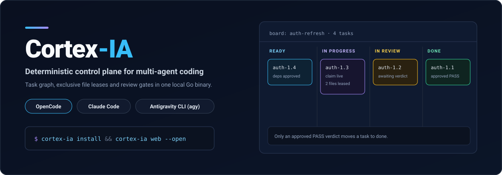
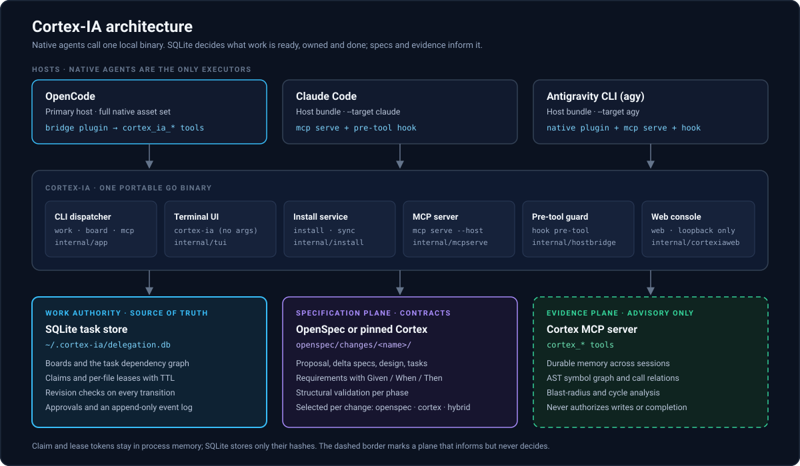

# Cortex-IA documentation

**Cortex-IA** is a local control plane for multi-agent software development on **OpenCode**,
**Claude Code** and **Antigravity CLI (agy)**. One Go binary installs the agent roles and owns the
task graph, file leases and review gates that make parallel agent work safe.

## Start here

| Quickstart | Installation | CLI reference | Architecture |
|---|---|---|---|
| Install, set up a host and open the console. | Every install method, prerequisites and updates. | Every command, flag and alias. | Planes, packages and invariants. |
| [Get started →](getting-started/quickstart.md) | [Install →](getting-started/installation.md) | [Look up →](reference/cli.md) | [Explore →](architecture/architecture.md) |

## The system in one picture

Agents run natively inside the host. They reach Cortex-IA through typed `cortex_ia_*` tools, and
Cortex-IA records every claim, lease, transition and approval in SQLite. Plan files and Cortex
memory inform the work; only SQLite decides its state.

## Documentation map

The documentation is organized by what you are trying to do.

### Get started

Learn by doing: from nothing to a working installation.

| Page | What it covers |
|---|---|
| [Quickstart](getting-started/quickstart.md) | First install, health check and first board |
| [Installation](getting-started/installation.md) | Install scripts, Go, Homebrew, source builds, updates |
| [Supported platforms](getting-started/platforms.md) | Operating systems, hosts, install paths and known limits |
| [Configuration](getting-started/configuration.md) | Flags, environment variables and state layout |
| [Non-interactive mode](getting-started/non-interactive.md) | Scripting, CI and exit codes |

### Guides

Task-oriented pages for running Cortex-IA day to day.

| Page | What it covers |
|---|---|
| [Agents](operations/agents.md) | The six roles, their authority and their receipts |
| [Planning](operations/planning.md) | When a change needs a plan, the plan file and the task lifecycle |
| [MCP manager](operations/mcp.md) | Catalog presets, custom servers, ownership and adoption |
| [Components](operations/components.md) | What is installed and which MCP servers are managed |
| [Cortex memory](operations/cortex-memory.md) | Memory, the AST graph and how it relates to work authority |
| [Web console](operations/web-console.md) | The loopback operations console and its API |
| [Usage stats and TUI](operations/stats-and-ui.md) | `cortex-ia stats` and the terminal cockpit |
| [Security and recovery](operations/security.md) | Fail-closed rules, verified backups and recovery |
| [Backups and rollback](operations/rollback.md) | Backup layout, retention and explicit rollback |
| [Docker E2E testing](operations/docker-e2e-testing.md) | The container-based end-to-end suite |

### Concepts and architecture

Background for understanding why the system behaves as it does.

| Page | What it covers |
|---|---|
| [Architecture](architecture/architecture.md) | Planes, the locking engine, the install pipeline, hardening |
| [Codebase guide](architecture/codebase-guide.md) | Reading path through the codebase pages below |
| [Mental model](architecture/codebase/mental-model.md) | End-to-end flow in one page |
| [Repository map](architecture/codebase/repository-map.md) | Directory-by-directory layout |
| [Interfaces](architecture/codebase/interfaces.md) | Core Go interfaces and data models |
| [MCP boundaries](architecture/codebase/mcp-boundaries.md) | Ownership and fail-closed conflicts for MCP entries |
| [Sync, state and backup](architecture/codebase/sync-and-cloud.md) | State files and reconciliation |
| [Dashboard and TUI](architecture/codebase/dashboard.md) | Bubble Tea architecture and screens |
| [Integrations and CI/CD](architecture/codebase/integrations.md) | Workflows, GoReleaser and distribution |
| [Project and extension guide](architecture/codebase/project-and-extension.md) | Adding skills, commands and MCP presets |
| [Maintainer playbook](architecture/codebase/maintainer-playbook.md) | Release runbook and dependency maintenance |

### Reference

Facts to look up.

| Page | What it covers |
|---|---|
| [CLI reference](reference/cli.md) | Every command group, syntax and purpose |
| [Reference map](architecture/codebase/reference-map.md) | Packages, key types, config and state files |
| [Updater verification](reference/updater-verification-profiles.md) | How self-update verifies release archives |
| [Release signing keys](operations/release-keys.md) | Retired signing scheme and the current checksum model |
| [Nan Ink theme](reference/nan-ink-theme.md) | Palette and theme activation |
| [Report hub snapshot](reference/cortex-report-hub-snapshot.md) | Error-report snapshot utility |
| [Qualification inputs](reference/qualification-inputs.md) · [SDK](reference/sdk-qualification.md) · [MCP](reference/mcp-qualification.md) | Pinned CI, SDK and MCP evidence |

### Project records

Dated, append-only material kept for traceability.

| Page | What it covers |
|---|---|
| [Audits](audits/README.md) | Dated audit reports |
| [Evidence](evidence/README.md) | Evidence files referenced by audits and reviews |
| [Agent evals](evals/agent-evals.md) | Protocol for comparing harness versions on real work |
| [Harness improvement paper](analysis/harness-improvement-paper.md) | Analysis behind the current harness design |
| [Authority adoption backlog](proposals/gentle-ai-authority-adoption-backlog.md) | Proposal backlog for durable-authority patterns |

## Conventions

- English is the canonical language. Pages with a Spanish twin use the `.es.md` suffix; the rest
  fall back to English on the Spanish site.
- Diagrams are SVG files under `assets/diagrams/`; see the [asset guide](assets/README.md) before
  adding or editing one.
- Commands in code blocks are meant to be copied as written. Placeholders use `<angle-brackets>`.

## Get involved

- Source code and releases: [github.com/lleontor705/cortex-ia](https://github.com/lleontor705/cortex-ia)
- Contribution guide: [CONTRIBUTING.md](https://github.com/lleontor705/cortex-ia/blob/main/CONTRIBUTING.md)
- Security policy: [SECURITY.md](https://github.com/lleontor705/cortex-ia/blob/main/SECURITY.md)
