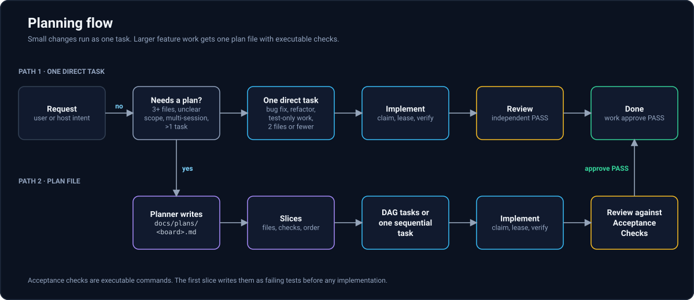
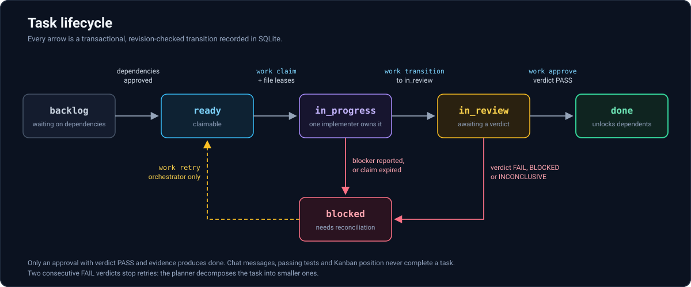

# Planificación y ciclo de vida de las tareas

Cortex-IA planifica el trabajo según su tamaño. La mayoría de los cambios se ejecutan directamente
como una sola tarea. El trabajo de funcionalidades más grande recibe un único archivo de plan breve
cuyos criterios de aceptación son comandos ejecutables. El plan se conserva en el repositorio como
historial; las pruebas son la especificación viva.

Cortex-IA no usa Desarrollo Guiado por Especificaciones (SDD). Las especificaciones obligatorias y el
espacio de trabajo OpenSpec se eliminaron porque añadían sobrecarga sin una ganancia medible en
correcciones de errores y refactorizaciones. Los comandos `cortex-ia openspec` y `cortex-ia work archive`
están retirados y fallan con un error de "retirado".



## Cuándo se necesita un plan

| Sin plan | Plan obligatorio |
|---|---|
| Corrección de un error con una prueba que lo reproduce | Trabajo de funcionalidad que toca 3 o más archivos |
| Refactorización con pruebas en verde | Requisitos poco claros |
| Trabajo solo de pruebas | Trabajo que abarca varias sesiones |
| Cambio que toca 2 archivos o menos | Más de una tarea |

El orquestador enruta la petición. Un plan nunca es una puerta de control en los casos sin plan.

## El archivo de plan

El planificador escribe exactamente un archivo, `docs/plans/<board-id>.md`, de 40 a 120 líneas, con
estas secciones en este orden:

````markdown
# <Título>

## Goal and Done
Qué logra el cambio y la condición observable que indica que está terminado.

## Context and Non-goals
Contexto relevante, restricciones y lo que este plan deliberadamente no hace.

## Acceptance Checks
| ID | Behaviour | Command | Expected |
|---|---|---|---|
| AC-1 | Rechaza un claim sin lease vigente | `go test ./internal/delegation -run '^TestClaimNeedsLease$' -count=1` | exit 0 |

## Slices
1. Nombre del slice: archivos, comprobaciones que satisface, dependencias de slices anteriores.

## Decisions and Surprises
Notas fechadas sobre las decisiones tomadas y todo lo que difirió del plan.

## Outcome
Se completa al terminar el trabajo: qué se entregó, qué comprobaciones pasaron y qué queda.
````

No hay sección de progreso. El estado de las tareas en la base de datos del tablero es el progreso.

Los criterios de aceptación son comandos ejecutables con un resultado esperado, no prosa. El primer
slice los escribe como pruebas que fallan (rojo) antes de cualquier implementación. Cada tarea lleva
sus comprobaciones como cadenas `AC-<n>: <comando>`, para que el veredicto del revisor nombre la
comprobación que cubre.

## Quién escribe qué

| Acción | Quién | Notas |
|---|---|---|
| Crear el tablero | `planner`, una vez, con el slug del orquestador | El orquestador no crea tableros |
| Escribir el archivo de plan | `planner` | Fases `plan` y `update` |
| Cambiar un criterio de aceptación | `planner`, fase `update` | El orquestador la despacha con el motivo; queda en Decisions and Surprises |
| Registrar sorpresas y decisiones | Los implementadores las informan en sus recibos; `planner`, fase `update`, las copia al plan | Los implementadores nunca reservan ni editan el archivo de plan |
| Completar Outcome | `planner`, fase `update`, al cierre | El orquestador la despacha tras la última aprobación |
| Descomponer una tarea bloqueada | `planner`, fase `decompose` | Los hijos se encadenan en orden |

El archivo de plan nunca está en los archivos permitidos de un slice, así que los slices paralelos no
colisionan en él.

## Slices y tareas

Un slice se convierte en su propia tarea DAG en el tablero solo si se cumplen las tres condiciones:

- sus archivos no se solapan con los de otro slice;
- puede retomarse solo con el texto de la petición más `git diff`;
- tiene sus propios criterios de aceptación.

En otro caso, los slices del plan se ejecutan como una única tarea secuencial. Toda dependencia debe
existir en el mismo tablero (ver la [referencia de la CLI](../reference/cli.es.md)).

## Flujos de trabajo

| Flujo | Uso | Puerta de salida |
|---|---|---|
| `direct-change` | Un cambio acotado sin plan | Claim y leases vigentes, comprobaciones proporcionales, nivel de revisión según la matriz |
| `fast-tdd` | Funcionalidad o corrección guiada por pruebas | Prueba que falla primero, la misma prueba en verde tras el cambio, aprobación independiente |
| `hotfix` | Contención urgente | Evidencia de regresión y una tarea de seguimiento estructural |
| `ops-task` | Scripts y pasos operativos | Script con salida 0 y verificación del objetivo |

El archivo de plan nunca es una aprobación por sí mismo.

## Cierre

No hay paso de archivado. Cuando se registra la última aprobación, el orquestador despacha al
planificador en fase `update`, que completa Outcome, y el archivo permanece en `docs/plans/`. El trabajo aprobado produce `done` mediante
`cortex-ia work approve`; no se requiere un cierre de especificación aparte.

## Ciclo de vida de las tareas

`backlog -> ready -> in_progress -> in_review -> done`



Solo una aprobación independiente con veredicto PASS produce `done`. Un fallo pasa la tarea a
`blocked`. La recuperación reconcilia la autoridad caducada, y el reintento requiere autoridad nueva.
La descomposición reemplaza una tarea demasiado grande por dependencias que conservan el alcance
aprobado. La posición en la interfaz de un tablero nunca autoriza trabajo.

El implementador reclama una tarea lista, reserva cada archivo escribible, renueva la autoridad,
verifica y transiciona a `in_review` con `cortex_ia_work_transition`. El revisor inspecciona el diff,
vuelve a ejecutar las comprobaciones y aprueba o rechaza con `cortex_ia_work_approve`. El propietario
de la implementación no puede revisar su propia tarea. Las responsabilidades de cada rol están en
[Agentes](agents.md).

El nivel de revisión sigue la Matriz Adaptativa de Casos de Revisión. Los tipos que no son código
(datos generados, documentación, configuración declarativa y scripts operativos) los aprueba
automáticamente el orquestador con un puntero de evidencia. El código de alto riesgo requiere un
revisor independiente. El nivel asignado es un mínimo: puede elevarse indicando el motivo, pero nunca
reducirse.

Las reglas autoritativas están en el contrato compartido `internal/assets/skills/_shared/cortex-work-protocol.md`,
instalado como `~/.cortex-ia/opencode/contracts/cortex-work-protocol.md`.
