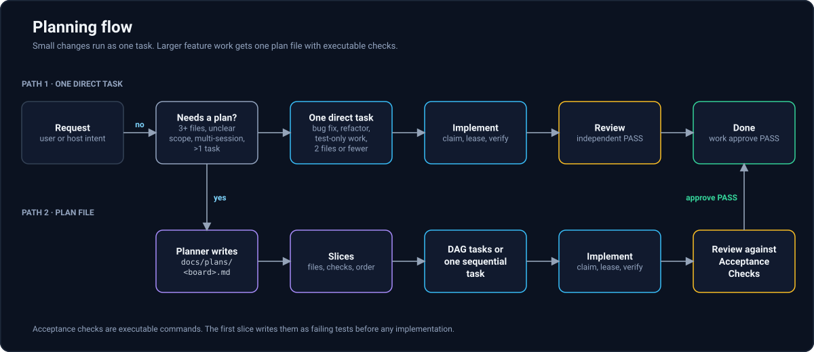
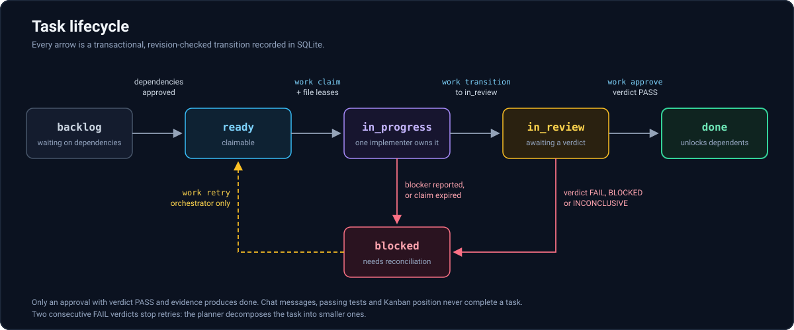

# Planning and task lifecycle

Cortex-IA plans work in proportion to its size. Most changes run directly as one task. Larger
feature work gets one short plan file whose acceptance checks are executable commands. The plan
stays in the repository as history; the tests are the living spec.

Cortex-IA does not use Spec-Driven Development. Mandatory specs and the OpenSpec workspace were
removed because they added overhead without a measurable gain on bug fixes and refactors. The
`cortex-ia openspec` and `cortex-ia work archive` commands are retired and fail with a "retired"
error.



## When a plan is needed

| No plan | Plan required |
|---|---|
| Bug fix with a reproducing test | Feature work touching 3 or more files |
| Refactor under green tests | Requirements that are unclear |
| Test-only work | Work that spans multiple sessions |
| Change touching 2 files or fewer | More than one task |

The orchestrator routes the request. A plan is never a gate for the no-plan cases.

## The plan file

The planner writes exactly one file, `docs/plans/<board-id>.md`, 40 to 120 lines, with these
sections in this order:

````markdown
# <Title>

## Goal and Done
What the change achieves, and the observable condition that means it is finished.

## Context and Non-goals
Relevant background, constraints, and what this plan deliberately does not do.

## Acceptance Checks
| ID | Behaviour | Command | Expected |
|---|---|---|---|
| AC-1 | Rejects a claim without a live lease | `go test ./internal/delegation -run '^TestClaimNeedsLease$' -count=1` | exit 0 |

## Slices
1. Slice name: files, checks it satisfies, dependencies on earlier slices.

## Decisions and Surprises
Dated notes on choices made and anything that differed from the plan.

## Outcome
Filled in when the work is done: what shipped, which checks passed, what remains.
````

There is no Progress section. Task state in the board database is the progress.

Acceptance checks are executable commands with an expected result, not prose. The first slice
writes them as failing tests (red) before any implementation. Each task carries its checks as
`AC-<n>: <command>` strings, so the reviewer's verdict can name the check it covers.

## Who writes what

| Action | Who | Notes |
|---|---|---|
| Create the board | `planner`, once, with the orchestrator's slug | The orchestrator does not create boards |
| Write the plan file | `planner` | Phases `plan`, `update` |
| Change an acceptance check | `planner`, phase `update` | Dispatched by the orchestrator with the reason; recorded in Decisions and Surprises |
| Record surprises and decisions | Implementers report them in receipts; `planner`, phase `update`, copies them into the plan | Implementers never lease or edit the plan file |
| Fill Outcome | `planner`, phase `update`, at close | Dispatched by the orchestrator after the last approval |
| Decompose a blocked task | `planner`, phase `decompose` | Children are chained in order |

The plan file is never in a slice's allowed files, so parallel slices do not collide on it.

## Slices and tasks

A slice becomes its own DAG task on the board only when all three hold:

- its files do not overlap with another slice's files;
- it is resumable from the request text plus `git diff` alone;
- it has its own acceptance checks.

Otherwise the plan's slices run as one sequential task. Every dependency must exist on the same
board (see [CLI reference](../reference/cli.md)).

## Workflows

| Workflow | Use for | Exit gate |
|---|---|---|
| `direct-change` | One bounded change with no plan | Live claim and leases, proportional checks, review tier per the matrix |
| `fast-tdd` | Feature or fix driven by tests | Failing test first, same test green after the change, independent approval |
| `hotfix` | Urgent containment | Regression evidence and a structural follow-up task |
| `ops-task` | Scripts and operational steps | Script exit 0 and target verification |

## Closure

There is no archive step. When the last approval is recorded, the orchestrator dispatches the planner
in phase `update`, which fills in Outcome, and the file stays in `docs/plans/`. Approved work produces `done` through
`cortex-ia work approve`; no separate spec closure is required.

## Task lifecycle

`backlog -> ready -> in_progress -> in_review -> done`



Only an independent approval with verdict PASS produces `done`. A failure enters `blocked`.
Recovery reconciles expired authority, and retry requires fresh authority. Decomposition replaces
an oversized task with dependencies that keep the approved scope. UI placement on a board never
authorizes work.

Implementers claim one ready task, reserve every writable file, renew authority, verify, and
transition to `in_review` with `cortex_ia_work_transition`. Reviewers inspect the diff, rerun the
checks, and approve or reject with `cortex_ia_work_approve`. The implementation owner cannot
review its own task. Role responsibilities are listed in [Agents](agents.md).

The review tier follows the Adaptive Review Case Matrix. Non-code kinds (generated data,
documentation, declarative config, and operational scripts) are auto-approved by the orchestrator
with an evidence pointer. High-risk code requires an independent reviewer. The assigned tier is a
floor: it may be raised with a stated reason and never lowered.

Authoritative rules live in the shared contract `internal/assets/skills/_shared/cortex-work-protocol.md`,
installed as `~/.cortex-ia/opencode/contracts/cortex-work-protocol.md`.
